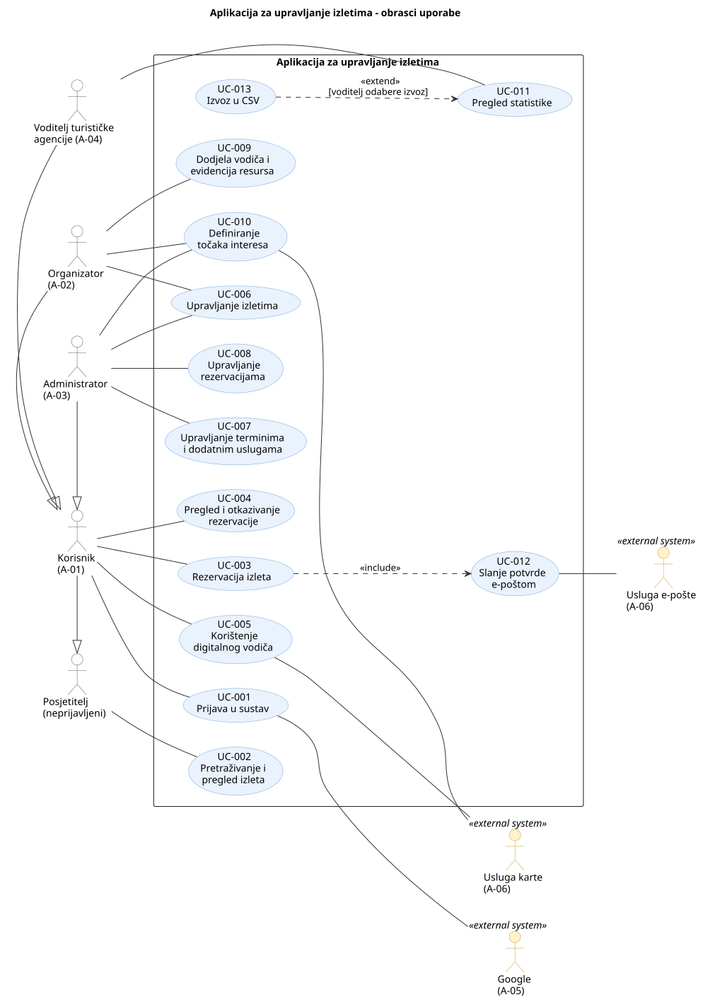

# 3. Obrasci uporabe

## 3.1 Dijagram obrazaca uporabe

**Slika 3.1. Dijagram obrazaca uporabe aplikacije za upravljanje izletima**

**PlantUML izvor:** [izvor](./puml/3-1-sustav-UC.puml)

Dijagram prikazuje granicu aplikacije, ljudske aktere s lijeve strane i vanjske sustave s desne strane. Posjetitelj (neprijavljeni) može samo pretraživati i pregledavati izlete. Korisnik nasljeđuje posjetitelja i uz to se prijavljuje, rezervira izlete, pregledava i otkazuje rezervacije te koristi digitalni vodič. Organizator, administrator i voditelj turističke agencije nasljeđuju korisnika jer svaki prijavljeni korisnik ima ulogu korisnika, a ostale uloge mu dodjeljuje administrator (AS-06). Slanje potvrde e-poštom (UC-012) uvijek je dio rezervacije pa je s njom povezano odnosom «include». Izvoz u CSV (UC-013) opcionalno proširuje pregled statistike odnosom «extend» kada voditelj odabere izvoz. Google sudjeluje u prijavi, usluga e-pošte u slanju potvrde, a usluga karte u digitalnom vodiču i definiranju točaka interesa.

## 3.2 Specifikacije obrazaca uporabe

### UC-001: Prijava u sustav

| Element specifikacije             | Opis                                                                                                                                                                                                                                                                                                                                                                                                                                                  |
| :-------------------------------- | :---------------------------------------------------------------------------------------------------------------------------------------------------------------------------------------------------------------------------------------------------------------------------------------------------------------------------------------------------------------------------------------------------------------------------------------------------- |
| **Primarni akter**                | Neprijavljeni posjetitelj (A-06) ili korisnik s prethodno dodijeljenom ulogom turista, organizatora ili administratora (A-01, A-02, A-03).                                                                                                                                                                                                                                                                                                                                            |
| **Sekundarni akter**              | Pružatelj identiteta Google (A-04)                                                                                                                                                                                                                                                                                                                                                                                                                    |
| **Povezani zahtjevi**             | F-001                                                                                                                                                                                                                                                                                                                                                                                                                                                 |
| **Preduvjeti**                    | Korisnik ima Google račun i nije prijavljen u aplikaciju.                                                                                                                                                                                                                                                                                                                                                                                             |
| **Glavni uspješni tok**           | 1. Korisnik odabire „Prijava putem Googlea”. 2. Aplikacija preusmjerava korisnika na Googleovu stranicu za prijavu. 3. Korisnik se prijavljuje svojim Google računom i odobrava pristup. 4. Google vraća korisnika u aplikaciju s potvrdom identiteta. 5. Aplikacija prepoznaje korisnika; ako se prijavljuje prvi put, stvara mu račun s ulogom korisnika(turista). 6. Aplikacija prikazuje ime korisnika i funkcije dopuštene njegovoj ulozi. |
| **Alternativni tokovi / Iznimke** | **3a — Korisnik odustaje:** korisnik zatvori Googleovu prijavu ili ne odobri pristup; vraća se u aplikaciju kao neprijavljen i radnje za prijavljene korisnike ostaju nedostupne. **4a — Prijava nije uspjela:** Google nije dostupan ili vrati grešku; aplikacija prikazuje poruku da prijava nije uspjela i nudi ponovni pokušaj.                                                                                                                |
| **Posljedice (ishod)**            | Korisnik je prijavljen i vidi funkcije dopuštene njegovoj ulozi. Dodatne korisničke uloge dodjeljuje administrator.                                                                                                                                                                                                                                                                                          |
### UC-002: Pretraživanje i pregled izleta

| Element specifikacije | Opis |
| :--- | :--- |
| **Primarni akter** | Neprijavljeni posjetitelj (A-06), prijavljeni korisnik (A-01). |
| **Povezani zahtjevi** | F-002, F-003 |
| **Preduvjeti** | Nema; pretraživanje je dostupno i neprijavljenim korisnicima (C-02). |
| **Glavni uspješni tok** | 1. Korisnik otvara popis izleta; aplikacija prikazuje dostupne izlete. 2. Korisnik unosi kriterije pretrage, npr. vrsta aktivnosti „biciklistička tura”, termin u svibnju, cijena do 50 € i 3 sudionika. 3. Aplikacija prikazuje izlete i termine koji odgovaraju zadanim kriterijima, uz informaciju o raspoloživosti mjesta. 4. Korisnik odabire jedan izlet. 5. Aplikacija prikazuje detalje izleta (naziv, opis, kategorija, trajanje, lokacija) i sve njegove termine s datumom, vremenom, mjestom polaska, cijenom i brojem slobodnih mjesta. |
| **Alternativni tokovi / Iznimke** | **3a — Nema rezultata:** Nijedan izlet ne odgovara kriterijima; aplikacija prikazuje poruku da nema rezultata, a korisnik mijenja kriterije i nastavlja od koraka 2. **5a — Termin je popunjen:** Aplikacija prikazuje da nema slobodnih mjesta, ali korisnik i dalje može odabrati termin i podnijeti zahtjev za rezervaciju (UC-003). |
| **Posljedice (ishod)** | Podaci se ne mijenjaju. Korisnik vidi detalje odabranog izleta i može krenuti s rezervacijom (UC-003). |

### UC-003: Rezervacija izleta

| Element specifikacije | Opis |
| :-- | :-- |
| **Primarni akter** | Korisnik (A-01) |
| **Sekundarni akter** | Usluga e-pošte (A-05), putem UC-012. |
| **Povezani zahtjevi** | F-004, F-005, F-007, F-021 |
| **Preduvjeti** | Korisnik je prijavljen u aplikaciju (UC-001) i odabrao je izlet s dostupnim terminom (UC-002). Termin može biti popunjen. |
| **Glavni uspješni tok** | 1. Korisnik odabire termin izleta i mogućnost „Rezerviraj”. 2. Aplikacija prikazuje obrazac za unos broja sudionika i odabir dodatnih usluga. 3. Korisnik unosi broj sudionika, npr. 3, i odabire dodatne usluge, npr. najam bicikla. 4. Aplikacija prikazuje sažetak rezervacije i ukupnu cijenu. 5. Korisnik potvrđuje rezervaciju. 6. Aplikacija provjerava raspoloživost mjesta i sprema rezervaciju. Ako ima dovoljno mjesta, rezervacija dobiva status `POTVRDENO`, a broj slobodnih mjesta smanjuje se za broj sudionika. 7. Aplikacija prikazuje potvrdu rezervacije s njezinim podacima i statusom. 8. Aplikacija šalje potvrdu rezervacije e-poštom (UC-012). |
| **Alternativni tokovi / Iznimke** | **3a — Neispravan broj sudionika:** Korisnik unosi nevaljan broj sudionika; aplikacija prikazuje pogrešku i traži ispravak. **5a — Korisnik odustaje:** Korisnik odustaje od rezervacije; podaci se ne spremaju. **6a — Nema dovoljno slobodnih mjesta:** Aplikacija sprema rezervaciju sa statusom `ZAHTJEV`, bez zauzimanja mjesta, i prikazuje korisniku da je rezervacija na listi čekanja. Kada se oslobodi dovoljno mjesta, sustav automatski potvrđuje odgovarajuću rezervaciju i šalje potvrdu e-poštom (UC-012). **6b — Mjesta su se popunila tijekom rezervacije:** Drugi korisnik istovremeno rezervira posljednja slobodna mjesta. Aplikacija sprječava prekoračenje kapaciteta i obrađuje rezervaciju prema toku 6a. **8a — Slanje e-pošte nije uspjelo:** Rezervacija ostaje potvrđena i vidljiva u pregledu rezervacija (UC-004), ali aplikacija ne uspijeva poslati poruku. |
| **Posljedice (ishod)** | Rezervacija je spremljena sa statusom `POTVRDENO` ako ima dovoljno slobodnih mjesta ili `ZAHTJEV` ako ih nema. Samo potvrđene rezervacije zauzimaju mjesta. Za potvrđenu rezervaciju pokreće se slanje e-pošte, a rezervacija sa statusom `ZAHTJEV` može se automatski potvrditi nakon oslobađanja kapaciteta. |

### UC-004: Pregled, izmjena i otkazivanje rezervacije

| Element specifikacije | Opis |
| :-- | :-- |
| **Primarni akter** | Korisnik (A-01) |
| **Povezani zahtjevi** | F-006, F-022, F-023 |
| **Preduvjeti** | Korisnik je prijavljen u aplikaciju (UC-001). |
| **Glavni uspješni tok** | 1. Korisnik otvara „Moje rezervacije”. 2. Aplikacija prikazuje popis korisnikovih rezervacija sa statusima (`ZAHTJEV`, `POTVRDENO`, `OTKAZANO`, `REALIZIRANO`). 3. Korisnik odabire jednu rezervaciju. 4. Aplikacija prikazuje podatke rezervacije: izlet, termin, broj sudionika, dodatne usluge, ukupnu cijenu i status. 5. Korisnik odabire mogućnost izmjene rezervacije. 6. Korisnik mijenja broj sudionika i/ili dodatne usluge te potvrđuje izmjenu. 7. Aplikacija provjerava raspoloživost kapaciteta, ažurira podatke rezervacije i ponovno izračunava ukupnu cijenu. Ako ima dovoljno mjesta, rezervacija dobiva ili zadržava status `POTVRDENO`. 8. Aplikacija prikazuje ažurirane podatke i status rezervacije. |
| **Alternativni tokovi / Iznimke** | **2a — Nema rezervacija:** Aplikacija prikazuje poruku da korisnik još nema rezervacija. **5a — Samo pregled rezervacije:** Korisnik ne odabire izmjenu ni otkazivanje; podaci ostaju nepromijenjeni. **5b — Otkazivanje rezervacije:** Korisnik odabire „Otkaži rezervaciju”. Aplikacija traži potvrdu otkazivanja. Nakon potvrde status se mijenja u `OTKAZANO`. Ako je rezervacija bila potvrđena, oslobađaju se zauzeta mjesta i sustav obrađuje listu čekanja (F-021). **5c — Rezervaciju nije moguće mijenjati ili otkazati:** Rezervacija je već otkazana ili realizirana; aplikacija ne dopušta izmjenu ni otkazivanje. **6a — Korisnik odustaje od izmjene:** Rezervacija ostaje nepromijenjena. **6b — Neispravan broj sudionika:** Korisnik unosi nevaljan broj sudionika; aplikacija prikazuje pogrešku i traži ispravak. **7a — Nema dovoljno slobodnih mjesta:** Aplikacija sprema izmijenjenu rezervaciju sa statusom `ZAHTJEV`, bez zauzimanja mjesta, i prikazuje korisniku da je rezervacija na listi čekanja. **7b — Oslobađanje mjesta nakon izmjene:** Ako se smanjenjem broja sudionika oslobode mjesta, sustav automatski obrađuje rezervacije s liste čekanja (F-021). |
| **Posljedice (ishod)** | Korisnik može pregledati svoje rezervacije, izmijeniti broj sudionika i dodatne usluge ili otkazati rezervaciju. Nakon izmjene ažuriraju se podaci, ukupna cijena i status rezervacije te zauzetost kapaciteta. Oslobađanjem mjesta sustav automatski obrađuje listu čekanja. 

### UC-005: Korištenje digitalnog vodiča

| Element specifikacije | Opis |
| :-- | :-- |
| **Primarni akter** | Prijavljeni korisnik (A-01). |
| **Sekundarni akter** | Kartografska usluga (A-07). |
| **Povezani zahtjevi** | F-008 |
| **Preduvjeti** | Korisnik je prijavljen u aplikaciju (UC-001), otvorio je izlet za koji su definirane točke interesa (UC-010) i koristi aplikaciju na mobilnom uređaju. |
| **Glavni uspješni tok** | 1. Korisnik otvara odabrani izlet i odabire „Digitalni vodič”. 2. Aplikacija traži dopuštenje za pristup lokaciji uređaja. 3. Korisnik dopušta pristup lokaciji. 4. Aplikacija prikazuje kartu s trenutačnim položajem korisnika i točkama interesa izleta. 5. Korisnik se kreće, a aplikacija ažurira njegov položaj na karti. 6. Kada se korisnik približi točki interesa, aplikacija automatski prikazuje njezin naziv, opis, značaj i zanimljivosti. 7. Korisnik zatvara informacije i nastavlja izlet; postupak se ponavlja od koraka 5. |
| **Alternativni tokovi / Iznimke** | **3a — Pristup lokaciji odbijen:** Aplikacija prikazuje kartu s točkama interesa bez položaja korisnika. Korisnik može ručno odabrati točku interesa i pregledati njezine informacije. **4a — Karta nije dostupna:** Aplikacija prikazuje popis točaka interesa s pripadajućim informacijama. **5a — Lokacija nije dostupna:** Ako uređaj ne može odrediti trenutačni položaj, aplikacija prikazuje odgovarajuću poruku. Korisnik i dalje može pregledavati točke interesa na karti. |
| **Posljedice (ishod)** | Podaci se ne mijenjaju. Korisnik tijekom izleta može pratiti svoj položaj na karti i dobivati informacije o obližnjim točkama interesa. |

### UC-006: Upravljanje izletima

| Element specifikacije | Opis |
| :-- | :-- |
| **Primarni akter** | Administrator (A-03), organizator (A-02). |
| **Povezani zahtjevi** | F-009, F-012 |
| **Preduvjeti** | Akter je prijavljen u aplikaciju (UC-001) i ima ulogu administratora ili organizatora. |
| **Glavni uspješni tok** | 1. Akter otvara stranicu za upravljanje izletima. 2. Aplikacija prikazuje popis izleta: administratoru sve izlete, a organizatoru samo njegove. 3. Akter odabire mogućnost „Novi izlet”. 4. Akter unosi podatke o izletu: naziv, opis, kategoriju, trajanje i lokaciju. Termini izleta s cijenom i kapacitetom definiraju se zasebno (UC-007). 5. Akter potvrđuje unos i sprema izlet. 6. Aplikacija provjerava unesene podatke, sprema izlet i prikazuje ga u ponudi. |
| **Alternativni tokovi / Iznimke** | **3a — Izmjena postojećeg izleta:** Akter odabire postojeći izlet, mijenja njegove podatke i sprema promjene. Aplikacija prikazuje ažurirane podatke. **3b — Brisanje izleta:** Akter odabire postojeći izlet i mogućnost „Obriši”. Nakon potvrde aplikacija uklanja izlet iz ponude. **3c — Organizator pokušava uređivati tuđi izlet:** Aplikacija odbija izmjenu ili brisanje izleta koji ne pripada organizatoru (F-012). **6a — Neispravni podaci:** Ako nedostaje obavezno polje ili je unesena neispravna vrijednost, aplikacija prikazuje pogrešku i ne sprema izlet. |
| **Posljedice (ishod)** | Izlet je dodan, izmijenjen ili uklonjen iz ponude. Administrator može upravljati svim izletima, dok organizator može upravljati samo vlastitim izletima. |

### UC-007: Upravljanje terminima i dodatnim uslugama

| Element specifikacije | Opis |
| :-- | :-- |
| **Primarni akter** | Administrator (A-03). |
| **Povezani zahtjevi** | F-010 |
| **Preduvjeti** | Administrator je prijavljen u aplikaciju (UC-001) i izlet postoji (UC-006). |
| **Glavni uspješni tok** | 1. Administrator odabire izlet za koji želi definirati termin. 2. Aplikacija prikazuje postojeće termine i mogućnost dodavanja novog termina. 3. Administrator unosi datum i vrijeme održavanja, mjesto polaska, cijenu, maksimalan broj sudionika i potreban broj vodiča, npr. 15. 5. 2027. u 9:00, polazak s Trga bana Jelačića, 20 mjesta, 45 € i 2 vodiča. 4. Administrator dodaje dostupne dodatne usluge s pripadajućim cijenama, npr. organizirani prijevoz 10 € i najam bicikla 15 €. 5. Administrator potvrđuje unos i sprema promjene. 6. Aplikacija provjerava unesene podatke, sprema termin i dodatne usluge te ih prikazuje korisnicima prilikom pregledavanja i rezervacije izleta (UC-002, UC-003). |
| **Alternativni tokovi / Iznimke** | **2a — Izmjena postojećeg termina:** Administrator odabire postojeći termin, mijenja njegove podatke ili dodatne usluge i sprema promjene. Aplikacija provjerava unesene podatke i ažurira termin. **2b — Brisanje termina:** Administrator odabire postojeći termin i mogućnost brisanja. Aplikacija provjerava postoje li rezervacije te, ako brisanje ne bi narušilo postojeće rezervacije, uklanja termin nakon potvrde. **3a — Termin u prošlosti:** Administrator unosi datum i vrijeme koji su već prošli; aplikacija prikazuje pogrešku i ne sprema termin. **3b — Smanjenje kapaciteta ispod broja rezerviranih mjesta:** Aplikacija odbija promjenu i prikazuje koliko je mjesta već zauzeto potvrđenim rezervacijama. **3c — Neispravni podaci:** Administrator unosi neispravnu cijenu, kapacitet ili drugi obavezni podatak; aplikacija prikazuje pogrešku i ne sprema promjene. |
| **Posljedice (ishod)** | Izlet ima dodane, izmijenjene ili uklonjene termine te ažurirane cijene, kapacitete i dodatne usluge. Korisnici vide aktualne podatke prilikom pregledavanja i rezervacije izleta. |

### UC-008: Upravljanje rezervacijama

| Element specifikacije | Opis |
| :-- | :-- |
| **Primarni akter** | Administrator (A-03). |
| **Povezani zahtjevi** | F-011, F-021 |
| **Preduvjeti** | Administrator je prijavljen u aplikaciju (UC-001). |
| **Glavni uspješni tok** | 1. Administrator otvara pregled rezervacija. 2. Aplikacija prikazuje popis rezervacija s podacima o izletu, terminu, korisniku, broju sudionika i statusu. 3. Administrator filtrira rezervacije prema izletu, terminu ili statusu. 4. Administrator odabire rezervaciju i mijenja njezin status, npr. iz `POTVRDENO` u `REALIZIRANO` nakon održanog izleta. 5. Aplikacija provjerava dopuštenost promjene, sprema novi status i prikazuje ga administratoru. 6. Korisnik može vidjeti ažurirani status u svojim rezervacijama (UC-004). |
| **Alternativni tokovi / Iznimke** | **3a — Nema rezultata:** Nijedna rezervacija ne odgovara odabranim kriterijima; aplikacija prikazuje odgovarajuću poruku. **4a — Otkazivanje rezervacije:** Administrator mijenja status rezervacije u `OTKAZANO`. Ako je rezervacija bila potvrđena, aplikacija oslobađa zauzeta mjesta i automatski obrađuje listu čekanja (F-021). **4b — Nedopuštena promjena statusa:** Administrator pokušava napraviti nedopuštenu promjenu, npr. iz `OTKAZANO` u `REALIZIRANO`. Aplikacija odbija promjenu i prikazuje poruku o pogrešci. **5a — Nema dovoljno slobodnih mjesta za potvrdu:** Ako administrator pokušava potvrditi rezervaciju sa statusom `ZAHTJEV`, a nema dovoljno mjesta, aplikacija ne dopušta potvrdu i zadržava postojeći status. |
| **Posljedice (ishod)** | Status rezervacije ažuriran je i vidljiv korisniku. Otkazivanjem potvrđene rezervacije oslobađaju se mjesta, a sustav automatski obrađuje listu čekanja. Nijedna promjena statusa ne smije uzrokovati prekoračenje kapaciteta termina. |

                                                                                                                                                                                         
### UC-009: Dodjela vodiča i evidencija resursa

| Element specifikacije | Opis |
| :-- | :-- |
| **Primarni akter** | Organizator (A-02). |
| **Povezani zahtjevi** | F-013, F-014 |
| **Preduvjeti** | Organizator je prijavljen u aplikaciju (UC-001) i postoji njegov izlet s definiranim terminom (UC-006, UC-007). Vodiči su evidentirani u sustavu, ali nemaju vlastite korisničke račune (C-05). |
| **Glavni uspješni tok** | 1. Organizator odabire svoj izlet i termin. 2. Aplikacija prikazuje potreban broj vodiča i popis vodiča raspoloživih u odabranom terminu. 3. Organizator odabire vodiče koje želi dodijeliti terminu. 4. Aplikacija provjerava njihovu raspoloživost, sprema dodjelu i prikazuje dodijeljene vodiče uz termin. 5. Organizator otvara pregled resursa, npr. prijevoza i opreme. 6. Aplikacija prikazuje ukupnu količinu pojedinog resursa i njegovu raspoloživost u odabranom terminu. 7. Organizator dodjeljuje potrebnu količinu resursa terminu, npr. 2 od 3 raspoloživa kombija. 8. Aplikacija provjerava raspoloživost resursa, sprema dodjelu i ažurira evidenciju zauzetosti. |
| **Alternativni tokovi / Iznimke** | **2a — Nema dovoljno raspoloživih vodiča:** Aplikacija prikazuje koliko vodiča nedostaje. Organizator može dodijeliti raspoložive vodiče ili odustati od dodjele. **3a — Vodič je već zauzet:** Organizator pokušava dodijeliti vodiča koji je zauzet u istom terminu. Aplikacija odbija dodjelu i prikazuje poruku o nedostupnosti. **3b — Prekoračen potreban broj vodiča:** Organizator pokušava dodijeliti više vodiča nego što je predviđeno za termin. Aplikacija ne dopušta dodjelu. **7a — Nema dovoljno raspoloživih resursa:** Organizator traži veću količinu resursa od raspoložive. Aplikacija prikazuje dostupnu količinu i ne sprema neispravnu dodjelu. **7b — Organizator odustaje:** Organizator prekida dodjelu resursa bez spremanja promjena. |
| **Posljedice (ishod)** | Termin ima evidentirane dodijeljene vodiče i resurse. Sustav ažurira njihovu zauzetost i sprječava dodjelu resursa iznad raspoloživih količina. |

### UC-010: Definiranje točaka interesa

| Element specifikacije | Opis |
| :-- | :-- |
| **Primarni akter** | Administrator (A-03), organizator (A-02). |
| **Sekundarni akter** | Kartografska usluga (A-07). |
| **Povezani zahtjevi** | F-015 |
| **Preduvjeti** | Akter je prijavljen u aplikaciju (UC-001) i izlet postoji (UC-006). Organizator može uređivati točke interesa samo za vlastite izlete. |
| **Glavni uspješni tok** | 1. Akter odabire izlet i mogućnost „Dodaj točku interesa”. 2. Aplikacija prikazuje obrazac za unos podataka o točki interesa. 3. Akter unosi naziv, kratak opis, značaj i zanimljivosti, npr. „Kula Lotrščak – srednjovjekovna kula s koje svaki dan u podne puca top”. 4. Akter odabire lokaciju točke interesa na karti. 5. Akter potvrđuje unos i sprema točku interesa. 6. Aplikacija provjerava unesene podatke, sprema točku s geografskim koordinatama i prikazuje je na karti izleta i u digitalnom vodiču (UC-005). |
| **Alternativni tokovi / Iznimke** | **4a — Karta nije dostupna:** Akter ručno unosi geografske koordinate točke interesa (geografsku širinu i dužinu). **5a — Lokacija nije zadana:** Akter nije odabrao lokaciju ni unio koordinate. Aplikacija prikazuje pogrešku i ne sprema točku interesa. **5b — Neispravni podaci:** Nedostaje obavezan podatak ili su koordinate neispravne. Aplikacija prikazuje pogrešku i traži ispravak. **5c — Organizator pokušava uređivati tuđi izlet:** Aplikacija odbija dodavanje ili izmjenu točaka interesa za izlet koji ne pripada organizatoru. |
| **Posljedice (ishod)** | Izlet ima novu točku interesa s pripadajućim podacima i geografskim koordinatama. Korisnici je mogu vidjeti na karti i dobiti informacije o njoj putem digitalnog vodiča (UC-005). |

### UC-011: Pregled statistike

| Element specifikacije | Opis |
| :-- | :-- |
| **Primarni akter** | Organizator (A-02). |
| **Povezani zahtjevi** | F-016 |
| **Preduvjeti** | Organizator je prijavljen u aplikaciju (UC-001). |
| **Glavni uspješni tok** | 1. Organizator otvara pregled statistike. 2. Aplikacija prikazuje mogućnost odabira razdoblja za koje se želi pregledati statistika. 3. Organizator odabire razdoblje, npr. svibanj 2027. 4. Aplikacija prikazuje statistiku njegovih izleta za odabrano razdoblje: broj rezervacija, popunjenost termina, ostvareni prihod te najpopularnije aktivnosti i dodatne usluge. 5. Organizator pregledava prikazane podatke i po potrebi odabire izvoz izvještaja u CSV formatu (UC-013). |
| **Alternativni tokovi / Iznimke** | **4a — Nema podataka:** Za odabrano razdoblje nema podataka o rezervacijama. Aplikacija prikazuje odgovarajuću poruku, a organizator može odabrati drugo razdoblje. **4b — Neispravno razdoblje:** Organizator odabire neispravan vremenski raspon. Aplikacija prikazuje pogrešku i traži ispravak. |
| **Posljedice (ishod)** | Podaci se ne mijenjaju. Organizator ima pregled statistike vlastitih izleta za odabrano razdoblje te mogućnost izvoza podataka u CSV formatu (UC-013). |

### UC-012: Slanje potvrde e-poštom

| Element specifikacije | Opis |
| :-- | :-- |
| **Primarni akter** | Nema izravnog primarnog aktera; slanje se pokreće nakon potvrde rezervacije (UC-003) ili automatskog potvrđivanja s liste čekanja (F-021). |
| **Sekundarni akter** | Usluga e-pošte (A-05). |
| **Povezani zahtjevi** | F-007, F-021 |
| **Preduvjeti** | Rezervacija je spremljena i ima status `POTVRDENO`. |
| **Glavni uspješni tok** | 1. Nakon potvrde rezervacije aplikacija priprema poruku s podacima o izletu, terminu, broju sudionika, dodatnim uslugama, ukupnoj cijeni i statusu rezervacije. 2. Aplikacija šalje poruku na e-adresu korisnika putem usluge e-pošte. 3. Usluga e-pošte prihvaća poruku za slanje. 4. Aplikacija završava postupak slanja potvrde. |
| **Alternativni tokovi / Iznimke** | **2a — Usluga e-pošte nije dostupna:** Aplikacija ne uspijeva poslati poruku. Rezervacija ostaje potvrđena i korisnik je može pregledati u svojim rezervacijama (UC-004). **2b — Nedostaje e-adresa korisnika:** Aplikacija ne može poslati potvrdu, ali rezervacija ostaje spremljena i potvrđena. |
| **Posljedice (ishod)** | Potvrda rezervacije poslana je putem usluge e-pošte. Status rezervacije ne mijenja se zbog uspjeha ili neuspjeha slanja poruke. |

### UC-013: Izvoz statistike u CSV

| Element specifikacije | Opis |
| :-- | :-- |
| **Primarni akter** | Organizator (A-02). |
| **Povezani zahtjevi** | F-017 |
| **Preduvjeti** | Organizator je prijavljen u aplikaciju (UC-001) i pregledava statistiku svojih izleta za odabrano razdoblje (UC-011). |
| **Glavni uspješni tok** | 1. Organizator odabire mogućnost „Izvezi u CSV”. 2. Aplikacija priprema CSV datoteku sa statističkim podacima za odabrano razdoblje, uključujući broj rezervacija, popunjenost, ostvareni prihod te popularnost aktivnosti i dodatnih usluga. 3. Aplikacija omogućuje preuzimanje datoteke. 4. Organizator preuzima CSV datoteku na svoj uređaj. |
| **Alternativni tokovi / Iznimke** | **1a — Nema podataka:** Za odabrano razdoblje nema podataka za izvoz. Aplikacija prikazuje odgovarajuću poruku. **3a — Izvoz nije uspio:** Aplikacija ne uspijeva pripremiti datoteku i prikazuje poruku o pogrešci. Organizator može ponovno pokušati. |
| **Posljedice (ishod)** | Organizator je preuzeo CSV datoteku sa statistikom vlastitih izleta. Podaci u sustavu ostaju nepromijenjeni. |

### UC-014: Upravljanje korisničkim ulogama

| Element specifikacije | Opis |
| :-- | :-- |
| **Primarni akter** | Administrator (A-03). |
| **Povezani zahtjevi** | F-018 |
| **Preduvjeti** | Administrator je prijavljen u aplikaciju (UC-001). Korisnik kojem se dodjeljuje uloga već ima račun u sustavu. |
| **Glavni uspješni tok** | 1. Administrator otvara upravljanje korisnicima. 2. Aplikacija prikazuje popis registriranih korisnika i njihovih uloga. 3. Administrator odabire korisnika kojem želi promijeniti ovlasti. 4. Aplikacija prikazuje njegove trenutačne uloge. 5. Administrator dodjeljuje ili uklanja dodatnu korisničku ulogu, npr. organizatora. 6. Aplikacija sprema promjene i ažurira korisničke ovlasti. 7. Korisniku su dostupne funkcionalnosti u skladu s dodijeljenim ulogama. |
| **Alternativni tokovi / Iznimke** | **3a — Korisnik ne postoji:** Aplikacija ne pronalazi odabranog korisnika i prikazuje odgovarajuću poruku. **5a — Administrator odustaje:** Promjene korisničkih uloga ne spremaju se. **6a — Neovlašten pristup:** Korisnik bez administratorskih ovlasti pokušava promijeniti uloge. Aplikacija odbija radnju i ne mijenja podatke. |
| **Posljedice (ishod)** | Korisnik ima ažurirane uloge i pripadajuće ovlasti. Funkcionalnosti sustava dostupne su samo korisnicima s odgovarajućim ovlastima. |

### UC-015: Ocjenjivanje i recenziranje izleta

| Element specifikacije | Opis |
| :-- | :-- |
| **Primarni akter** | Prijavljeni korisnik (A-01). |
| **Povezani zahtjevi** | F-019 |
| **Preduvjeti** | Korisnik je prijavljen u aplikaciju (UC-001) i ima realiziranu rezervaciju za izlet koji želi ocijeniti. |
| **Glavni uspješni tok** | 1. Korisnik otvara detalje odabranog izleta (UC-002). 2. Aplikacija prikazuje postojeće ocjene i recenzije te mogućnost dodavanja vlastite recenzije. 3. Korisnik odabire mogućnost „Ocijeni izlet”. 4. Korisnik unosi ocjenu i tekst recenzije. 5. Korisnik potvrđuje unos. 6. Aplikacija provjerava unesene podatke, sprema ocjenu i recenziju te ih prikazuje uz izlet. |
| **Alternativni tokovi / Iznimke** | **3a — Korisnik nije sudjelovao na izletu**: Aplikacija ne dopušta ocjenjivanje ako korisnik nema realiziranu rezervaciju za odabrani izlet. **4a — Neispravni podaci:** Korisnik unosi nevaljanu ocjenu ili ne ispuni obavezno polje. Aplikacija prikazuje pogrešku i traži ispravak. **5a — Korisnik odustaje:** Ocjena i recenzija ne spremaju se. |
| **Posljedice (ishod)** | Ocjena i recenzija izleta spremljene su u sustav i dostupne za pregled drugim korisnicima. |

### UC-016: Ocjenjivanje i recenziranje vodiča

| Element specifikacije | Opis |
| :-- | :-- |
| **Primarni akter** | Prijavljeni korisnik (A-01). |
| **Povezani zahtjevi** | F-020 |
| **Preduvjeti** | Korisnik je prijavljen u aplikaciju (UC-001) i ima realiziranu rezervaciju za izlet na čijem je terminu sudjelovao odabrani vodič. |
| **Glavni uspješni tok** | 1. Korisnik otvara podatke o izletu i odabire vodiča kojeg želi ocijeniti. 2. Aplikacija prikazuje postojeće ocjene i recenzije odabranog vodiča. 3. Korisnik odabire mogućnost „Ocijeni vodiča”. 4. Korisnik unosi ocjenu i tekst recenzije. 5. Korisnik potvrđuje unos. 6. Aplikacija provjerava unesene podatke, sprema ocjenu i recenziju te ih prikazuje uz vodiča. |
| **Alternativni tokovi / Iznimke** |**3a — Korisnik nije sudjelovao na izletu s odabranim vodičem**: Aplikacija ne dopušta ocjenjivanje vodiča ako korisnik nema realiziranu rezervaciju za termin kojem je taj vodič bio dodijeljen.  **4a — Neispravni podaci:** Korisnik unosi nevaljanu ocjenu ili ne ispuni obavezno polje. Aplikacija prikazuje pogrešku i traži ispravak. **5a — Korisnik odustaje:** Ocjena i recenzija ne spremaju se. |
| **Posljedice (ishod)** | Ocjena i recenzija vodiča spremljene su u sustav i dostupne za pregled drugim korisnicima. |

## 3.3 Provjera dosljednosti obrazaca uporabe

**Cilj:** Provjeriti međusobnu usklađenost obrazaca uporabe, aktera, zahtjeva i ispitnih slučajeva. Cjelovito mapiranje održava se isključivo u **[matrici sljedivosti zahtjeva](2-Analiza-zahtjeva.md#26-sljedivost-zahtjeva)**.

| Provjera   | Pitanje za tim                                                                                                              |
| ---------- | --------------------------------------------------------------------------------------------------------------------------- |
| Zahtjev    | Je li svaki važan obrazac uporabe povezan s postojećim zahtjevom?                                                           |
| Akter      | Odgovara li akter naveden ovdje prethodno utvrđenoj ulozi i dopuštenoj interakciji?                                         |
| Aplikacija | Može li tim demonstrirati opisani glavni rezultat i važnu alternativu ili je opis jasno označen kao trenutačno oblikovanje? |

---

| Provjera | Rezultat |
| --- | --- |
| Zahtjev | Svih 13 obrazaca uporabe poziva se na postojeće zahtjeve iz odjeljka 2.1, a svaki funkcijski zahtjev F-001 do F-017 pokriven je barem jednim obrascem uporabe. |
| Akter | Akteri u obrascima uporabe i na dijagramu 3.1 odgovaraju akterima A-01 do A-06 iz odjeljka 2.3. |
| Aplikacija | Poslužitelj trenutačno ostvaruje pregled i upravljanje izletima i terminima (UC-002, UC-006, UC-007), stvaranje rezervacije s provjerom slobodnih mjesta (UC-003) i upravljanje resursima (UC-009). Ostali obrasci uporabe opisuju trenutačno oblikovanje. |

Povezivanje zahtjev → obrazac uporabe → ispitivanje održavajte **samo jednom, u [tablici sljedivosti zahtjeva](./2-Analiza-zahtjeva.md)**. Ovdje nemojte održavati drugu projektnu tablicu mapiranja ni stupac sa statusom implementacije. Ako važan zahtjev nema interakciju s ljudskim akterom, objasnite gdje se obrađuje umjesto izmišljanja aktera.

<strong>Provjera pokrivenosti zahtjeva</strong>

**Primjer — CrisisMap:** Tablica pokrivenosti obrazaca uporabe koju treba analizirati:

| Broj obrasca uporabe | Naziv obrasca uporabe    | Obuhvaćeni funkcijski zahtjevi                  |
| -------------------- | ------------------------ | ----------------------------------------------- |
| UC-001               | Registracija računa      | F-001: Registracija računa putem e-pošte        |
| UC-002               | Prijava kriznog događaja | F-022: Prijava i provjera kriznog događaja      |
| UC-003               | Sustav upozorenja        | F-045: Slanje upozorenja korisnicima i timovima |
| UC-004               | Koordinacija spašavanja  | F-067: Koordinacija s hitnim službama           |

---

**Problemi pokrivenosti koje treba riješiti:**

- **Pogrešan ID zahtjeva:** ova tablica povezuje UC-002 s F-022, dok se opis UC-002 u odjeljku 3.2 poziva na F-004, zahtjev za podnošenje prijave iz odjeljka 2.1.
- **Zahtjevi koji ne postoje:** F-022, F-045 i F-067 nisu definirani u oglednim zahtjevima u 2.1.
- **Obrasci uporabe bez opisa:** UC-003 i UC-004 nemaju opis u 3.2. UC-004 (koordinacija s hitnim službama) ujedno je mogućnost s vanjskim posljedicama koju opseg dopušta samo ako je uključena u odobreni zadatak.
- **Nesklad aktera:** primjer aktera u odjeljku 2.3 navodi da koordinator pomoći podnosi prijave (F-004), dok UC-002 kao primarnog aktera navodi građanina.

**Završna provjera:** Dijagram, specifikacije obrazaca uporabe i matrica sljedivosti međusobno su usklađeni. Svaki važan obrazac uporabe povezan je s postojećim zahtjevom, akteri odgovaraju stvarnim ulogama u aplikaciji, a opisani glavni i alternativni tijekovi odgovaraju ponašanju koje sustav stvarno podržava.
