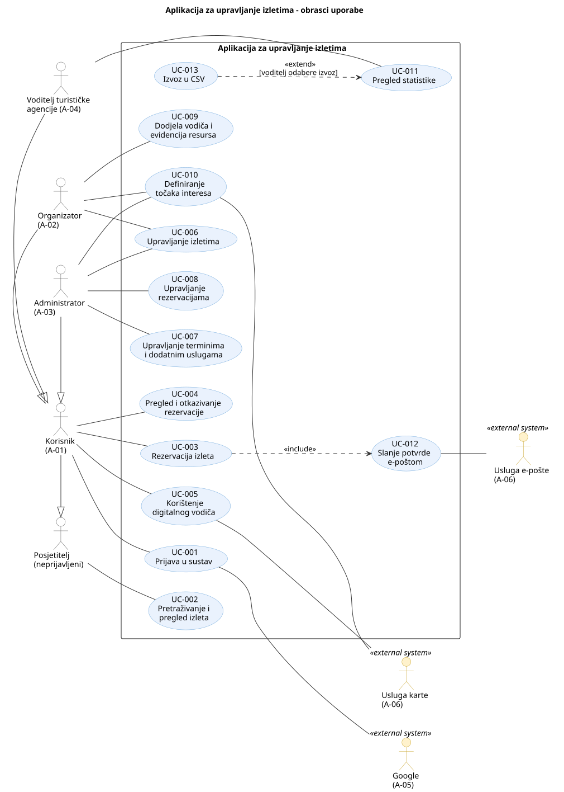

# 3. Obrasci uporabe

## 3.1 Dijagram obrazaca uporabe

**Slika 3.1. Dijagram obrazaca uporabe aplikacije za upravljanje izletima**

**PlantUML izvor:** [izvor](./puml/3-1-sustav-UC.puml)

Dijagram prikazuje granicu aplikacije, ljudske aktere s lijeve strane i vanjske sustave s desne strane. Posjetitelj (neprijavljeni) može samo pretraživati i pregledavati izlete. Korisnik nasljeđuje posjetitelja i uz to se prijavljuje, rezervira izlete, pregledava i otkazuje rezervacije te koristi digitalni vodič. Organizator, administrator i voditelj turističke agencije nasljeđuju korisnika jer svaki prijavljeni korisnik ima ulogu korisnika, a ostale uloge mu dodjeljuje administrator (AS-06). Slanje potvrde e-poštom (UC-012) uvijek je dio rezervacije pa je s njom povezano odnosom «include». Izvoz u CSV (UC-013) opcionalno proširuje pregled statistike odnosom «extend» kada voditelj odabere izvoz. Google sudjeluje u prijavi, usluga e-pošte u slanju potvrde, a usluga karte u digitalnom vodiču i definiranju točaka interesa.

## 3.2 Specifikacije obrazaca uporabe

### UC-001: Prijava u sustav

| Element specifikacije             | Opis                                                                                                                                                                                                                                                                                                                                                                                                                                                  |
| :-------------------------------- | :---------------------------------------------------------------------------------------------------------------------------------------------------------------------------------------------------------------------------------------------------------------------------------------------------------------------------------------------------------------------------------------------------------------------------------------------------- |
| **Primarni akter**                | Korisnik (A-01); na isti način se prijavljuju i organizator, administrator i voditelj turističke agencije                                                                                                                                                                                                                                                                                                                                             |
| **Sekundarni akter**              | Pružatelj identiteta Google (A-05)                                                                                                                                                                                                                                                                                                                                                                                                                    |
| **Povezani zahtjevi**             | F-001                                                                                                                                                                                                                                                                                                                                                                                                                                                 |
| **Preduvjeti**                    | Korisnik ima Google račun i nije prijavljen u aplikaciju.                                                                                                                                                                                                                                                                                                                                                                                             |
| **Glavni uspješni tok**           | 1. Korisnik odabire „Prijava putem Googlea”. 2. Aplikacija preusmjerava korisnika na Googleovu stranicu za prijavu. 3. Korisnik se prijavljuje svojim Google računom i odobrava pristup. 4. Google vraća korisnika u aplikaciju s potvrdom identiteta. 5. Aplikacija prepoznaje korisnika; ako se prijavljuje prvi put, stvara mu račun s ulogom korisnika. 6. Aplikacija prikazuje ime korisnika i funkcije dopuštene njegovoj ulozi. |
| **Alternativni tokovi / Iznimke** | **3a — Korisnik odustaje:** korisnik zatvori Googleovu prijavu ili ne odobri pristup; vraća se u aplikaciju kao neprijavljen i radnje za prijavljene korisnike ostaju nedostupne. **4a — Prijava nije uspjela:** Google nije dostupan ili vrati grešku; aplikacija prikazuje poruku da prijava nije uspjela i nudi ponovni pokušaj.                                                                                                                |
| **Posljedice (ishod)**            | Korisnik je prijavljen i vidi funkcije dopuštene njegovoj ulozi. Ulogu organizatora, administratora ili voditelja agencije dodjeljuje administrator (AS-06).                                                                                                                                                                                                                                                                                          |

### UC-002: Pretraživanje i pregled izleta

| Element specifikacije             | Opis                                                                                                                                                                                                                                                                                                                                                                                                                                                                                                                            |
| :-------------------------------- | :------------------------------------------------------------------------------------------------------------------------------------------------------------------------------------------------------------------------------------------------------------------------------------------------------------------------------------------------------------------------------------------------------------------------------------------------------------------------------------------------------------------------------ |
| **Primarni akter**                | Korisnik (A-01), prijavljen ili neprijavljen                                                                                                                                                                                                                                                                                                                                                                                                                                                                                    |
| **Povezani zahtjevi**             | F-002, F-003                                                                                                                                                                                                                                                                                                                                                                                                                                                                                                                    |
| **Preduvjeti**                    | Nema; pretraživanje je dostupno i neprijavljenim korisnicima (AS-01).                                                                                                                                                                                                                                                                                                                                                                                                                                                           |
| **Glavni uspješni tok**           | 1. Korisnik otvara popis izleta; aplikacija prikazuje dostupne izlete. 2. Korisnik unosi kriterije pretrage, npr. vrsta aktivnosti „biciklistička tura”, termin u svibnju, cijena do 50 € i 3 sudionika. 3. Aplikacija prikazuje izlete koji odgovaraju svim kriterijima i imaju termin s dovoljno slobodnih mjesta. 4. Korisnik odabire jedan izlet. 5. Aplikacija prikazuje detalje izleta (naziv, opis, kategorija, trajanje, lokacija) i sve njegove termine s datumom, mjestom polaska, cijenom i brojem slobodnih mjesta. |
| **Alternativni tokovi / Iznimke** | **3a — Nema rezultata:** nijedan izlet ne odgovara kriterijima; aplikacija prikazuje poruku da nema rezultata, a korisnik mijenja kriterije i nastavlja od koraka 2.                                                                                                                                                                                                                                                                                                                                                            |
| **Posljedice (ishod)**            | Podaci se ne mijenjaju. Korisnik vidi detalje odabranog izleta i može krenuti s rezervacijom (UC-003).                                                                                                                                                                                                                                                                                                                                                                                                                          |

### UC-003: Rezervacija izleta
| Element specifikacije | Opis |
| :-- | :-- |
| **Primarni akter** | Korisnik (A-01) |
| **Sekundarni akter** | Usluga e-pošte (A-06), preko uključenog UC-012 |
| **Povezani zahtjevi** | F-004, F-005, F-007 |
| **Preduvjeti** | Korisnik je prijavljen (UC-001) i otvorio je detalje izleta (UC-002). Izlet ima barem jedan termin sa slobodnim mjestima. |
| **Glavni uspješni tok** | 1. Korisnik odabire termin izleta i „Rezerviraj”. 2. Aplikacija prikazuje obrazac za broj osoba i dodatne usluge koje izlet nudi. 3. Korisnik unosi broj osoba, npr. 3, i odabire dodatne usluge, npr. najam bicikla. 4. Aplikacija prikazuje sažetak rezervacije i ukupnu cijenu. 5. Korisnik potvrđuje rezervaciju. 6. Aplikacija provjerava ima li termin dovoljno slobodnih mjesta, sprema rezervaciju i smanjuje broj slobodnih mjesta. 7. Rezervacija automatski dobiva status „potvrđena” (AS-03); aplikacija prikazuje potvrdu. 8. Aplikacija šalje korisniku potvrdu rezervacije e-poštom (uključuje UC-012). |
| **Alternativni tokovi / Iznimke** | **1a — Korisnik nije prijavljen:** aplikacija traži prijavu (UC-001); nakon uspješne prijave tok se nastavlja od koraka 2. **1b — Termin je popunjen:** rezervacija tog termina nije ponuđena; aplikacija prikazuje da nema slobodnih mjesta. **3a — Premalo slobodnih mjesta:** korisnik traži više mjesta nego što ih ima (npr. traži 3, a slobodna su 2); aplikacija prikazuje broj slobodnih mjesta, a korisnik mijenja broj osoba ili odabire drugi termin. **5a — Korisnik odustaje:** rezervacija se ne sprema. **6a — Mjesta su se popunila u međuvremenu:** drugi korisnik je istodobno rezervirao zadnja mjesta; aplikacija odbija rezervaciju, ništa ne sprema i obavještava korisnika. **8a — Slanje e-pošte nije uspjelo:** rezervacija ostaje potvrđena i vidljiva u pregledu rezervacija (UC-004), ali potvrda ne stiže na e-poštu. |
| **Posljedice (ishod)** | Rezervacija je spremljena sa statusom „potvrđena”, broj slobodnih mjesta termina smanjen je za broj osoba, a korisnik je primio potvrdu e-poštom. |

### UC-004: Pregled i otkazivanje rezervacije

| Element specifikacije             | Opis                                                                                                                                                                                                                                                                                                                                                                                                                                                                                                                                        |
| :-------------------------------- | :------------------------------------------------------------------------------------------------------------------------------------------------------------------------------------------------------------------------------------------------------------------------------------------------------------------------------------------------------------------------------------------------------------------------------------------------------------------------------------------------------------------------------------------ |
| **Primarni akter**                | Korisnik (A-01)                                                                                                                                                                                                                                                                                                                                                                                                                                                                                                                             |
| **Povezani zahtjevi**             | F-006                                                                                                                                                                                                                                                                                                                                                                                                                                                                                                                                       |
| **Preduvjeti**                    | Korisnik je prijavljen (UC-001).                                                                                                                                                                                                                                                                                                                                                                                                                                                                                                            |
| **Glavni uspješni tok**           | 1. Korisnik otvara „Moje rezervacije”. 2. Aplikacija prikazuje popis korisnikovih rezervacija sa statusom (zahtjev, potvrđena, otkazana, realizirana). 3. Korisnik odabire jednu rezervaciju. 4. Aplikacija prikazuje njezine podatke: izlet, termin, broj osoba, dodatne usluge, ukupnu cijenu i status. 5. Korisnik odabire „Otkaži rezervaciju” (AS-02). 6. Aplikacija traži potvrdu otkazivanja. 7. Korisnik potvrđuje otkazivanje. 8. Aplikacija mijenja status rezervacije u „otkazana” i vraća mjesta u termin. |
| **Alternativni tokovi / Iznimke** | **2a — Nema rezervacija:** aplikacija prikazuje poruku da korisnik još nema rezervacija. **5a — Rezervaciju nije moguće otkazati:** rezervacija je već otkazana ili realizirana; opcija otkazivanja nije ponuđena. **7a — Korisnik odustaje:** rezervacija ostaje nepromijenjena.                                                                                                                                                                                                                                                     |
| **Posljedice (ishod)**            | Ako korisnik samo pregledava, podaci se ne mijenjaju. Nakon otkazivanja rezervacija ima status „otkazana”, a broj slobodnih mjesta u terminu povećan je za broj osoba iz rezervacije.                                                                                                                                                                                                                                                                                                                                                       |

### UC-005: Korištenje digitalnog vodiča

| Element specifikacije             | Opis                                                                                                                                                                                                                                                                                                                                                                                                                                                                                                                                                                                           |
| :-------------------------------- | :--------------------------------------------------------------------------------------------------------------------------------------------------------------------------------------------------------------------------------------------------------------------------------------------------------------------------------------------------------------------------------------------------------------------------------------------------------------------------------------------------------------------------------------------------------------------------------------------- |
| **Primarni akter**                | Korisnik (A-01)                                                                                                                                                                                                                                                                                                                                                                                                                                                                                                                                                                                |
| **Sekundarni akter**              | Vanjske usluge – usluga karte (A-06)                                                                                                                                                                                                                                                                                                                                                                                                                                                                                                                                                           |
| **Povezani zahtjevi**             | F-008                                                                                                                                                                                                                                                                                                                                                                                                                                                                                                                                                                                          |
| **Preduvjeti**                    | Korisnik je prijavljen (UC-001) i ima rezervaciju za izlet. Za izlet su definirane točke interesa (UC-010).                                                                                                                                                                                                                                                                                                                                                                                                                                                                                    |
| **Glavni uspješni tok**           | 1. Korisnik na mobitelu otvara rezervirani izlet i odabire „Digitalni vodič”. 2. Aplikacija traži dopuštenje za pristup lokaciji uređaja. 3. Korisnik dopušta pristup lokaciji. 4. Aplikacija prikazuje kartu s trenutačnim položajem korisnika i točkama interesa izleta. 5. Korisnik se kreće; aplikacija osvježava njegov položaj na karti. 6. Kada se korisnik približi točki interesa (npr. na manje od 100 m), aplikacija prikazuje njezin naziv, kratak opis, značaj i zanimljivosti. 7. Korisnik zatvara informacije i nastavlja izlet; tok se ponavlja od koraka 5. |
| **Alternativni tokovi / Iznimke** | **3a — Pristup lokaciji odbijen:** aplikacija prikazuje kartu s točkama interesa bez položaja korisnika; informacije o točki prikazuju se kada je korisnik sam odabere na karti. **4a — Karta nije dostupna:** aplikacija prikazuje popis točaka interesa s njihovim informacijama. **5a — Lokacija nije dostupna (slab GPS signal):** aplikacija prikazuje posljednji poznati položaj i poruku da lokacija trenutačno nije dostupna.                                                                                                                                                    |
| **Posljedice (ishod)**            | Podaci se ne mijenjaju. Korisnik tijekom izleta dobiva informacije o mjestima u svojoj blizini.                                                                                                                                                                                                                                                                                                                                                                                                                                                                                                |

### UC-006: Upravljanje izletima

| Element specifikacije             | Opis                                                                                                                                                                                                                                                                                                                                                                                                                                                                                                                                                        |
| :-------------------------------- | :---------------------------------------------------------------------------------------------------------------------------------------------------------------------------------------------------------------------------------------------------------------------------------------------------------------------------------------------------------------------------------------------------------------------------------------------------------------------------------------------------------------------------------------------------------- |
| **Primarni akter**                | Administrator (A-03), Organizator (A-02)                                                                                                                                                                                                                                                                                                                                                                                                                                                                                                                    |
| **Povezani zahtjevi**             | F-009, F-012                                                                                                                                                                                                                                                                                                                                                                                                                                                                                                                                                |
| **Preduvjeti**                    | Akter je prijavljen i ima ulogu administratora ili organizatora.                                                                                                                                                                                                                                                                                                                                                                                                                                                                                            |
| **Glavni uspješni tok**           | 1. Akter otvara upravljanje izletima. 2. Aplikacija prikazuje popis izleta: administratoru sve izlete, a organizatoru samo njegove. 3. Akter odabire „Novi izlet”. 4. Akter unosi podatke: naziv, opis, kategoriju, trajanje i lokaciju. Termini izleta s cijenom i kapacitetom dodaju se zatim u UC-007. 5. Akter sprema izlet. 6. Aplikacija provjerava obavezna polja, sprema izlet i prikazuje ga korisnicima. |
| **Alternativni tokovi / Iznimke** | **3a — Izmjena izleta:** akter odabire postojeći izlet, mijenja podatke i sprema; aplikacija prikazuje izmijenjene podatke korisnicima. **3b — Brisanje izleta:** akter odabire postojeći izlet i „Obriši”; nakon potvrde aplikacija uklanja izlet iz ponude. **3c — Organizator pokušava mijenjati tuđi izlet:** aplikacija ne nudi izmjenu ni brisanje i odbija takvu radnju (F-012). **6a — Neispravni podaci:** nedostaje obavezno polje ili je vrijednost neispravna (npr. negativno trajanje); aplikacija označava pogrešku i ne sprema izlet. |
| **Posljedice (ishod)**            | Izlet je dodan, izmijenjen ili uklonjen, a promjena je vidljiva korisnicima.                                                                                                                                                                                                                                                                                                                                                                                                                                                                                |

### UC-007: Upravljanje terminima i dodatnim uslugama

| Element specifikacije             | Opis                                                                                                                                                                                                                                                                                                                                                                                             |
| :-------------------------------- | :----------------------------------------------------------------------------------------------------------------------------------------------------------------------------------------------------------------------------------------------------------------------------------------------------------------------------------------------------------------------------------------------- |
| **Primarni akter**                | Administrator (A-03)                                                                                                                                                                                                                                                                                                                                                                             |
| **Povezani zahtjevi**             | F-010                                                                                                                                                                                                                                                                                                                                                                                            |
| **Preduvjeti**                    | Administrator je prijavljen i izlet postoji (UC-006).                                                                                                                                                                                                                                                                                                                                            |
| **Glavni uspješni tok**           | 1. Administrator odabire izlet. 2. Administrator dodaje termin: datum i vrijeme, mjesto polaska, kapacitet, cijenu i potreban broj vodiča, npr. 15. 5. 2027. u 9:00, polazak s Trga bana Jelačića, 20 mjesta, 45 €, 2 vodiča. 3. Administrator dodaje dodatne usluge s cijenom, npr. organizirani prijevoz 10 €, najam bicikla 15 €. 4. Administrator sprema promjene. 5. Aplikacija sprema termine i usluge te ih prikazuje korisnicima pri rezervaciji (UC-003). |
| **Alternativni tokovi / Iznimke** | **2a — Termin u prošlosti:** aplikacija javlja pogrešku i ne sprema termin. **2b — Smanjenje kapaciteta ispod broja rezerviranih mjesta:** aplikacija odbija promjenu i prikazuje koliko je mjesta već rezervirano. **2c — Neispravna cijena ili kapacitet:** npr. negativna cijena ili kapacitet 0; aplikacija označava pogrešku i ne sprema termin. |                                                                                                                                                                         
| **Posljedice (ishod)**            | Izlet ima ažurirane termine, kapacitete, cijene i dodatne usluge koje korisnici mogu rezervirati.                                                                                                                                                                                                                                                                                                |

### UC-008: Upravljanje rezervacijama

| Element specifikacije             | Opis                                                                                                                                                                                                                                                                                                                                                                                                                                |
| :-------------------------------- | :---------------------------------------------------------------------------------------------------------------------------------------------------------------------------------------------------------------------------------------------------------------------------------------------------------------------------------------------------------------------------------------------------------------------------------- |
| **Primarni akter**                | Administrator (A-03)                                                                                                                                                                                                                                                                                                                                                                                                                |
| **Povezani zahtjevi**             | F-011                                                                                                                                                                                                                                                                                                                                                                                                                               |
| **Preduvjeti**                    | Administrator je prijavljen.                                                                                                                                                                                                                                                                                                                                                                                                        |
| **Glavni uspješni tok**           | 1. Administrator otvara pregled rezervacija. 2. Aplikacija prikazuje sve rezervacije s izletom, terminom, korisnikom, brojem osoba i statusom. 3. Administrator filtrira rezervacije, npr. po izletu, terminu ili statusu. 4. Administrator odabire rezervaciju i mijenja joj status, npr. u „realizirana” nakon održanog izleta. 5. Aplikacija sprema novi status, a korisnik ga vidi u svojim rezervacijama (UC-004). |
| **Alternativni tokovi / Iznimke** | **4a — Otkazivanje rezervacije:** kad administrator postavi status „otkazana”, aplikacija vraća mjesta u termin. **4b — Nedopuštena promjena statusa:** npr. otkazana rezervacija ne može postati realizirana; aplikacija odbija promjenu.                                                                                                                                                                                       |
| **Posljedice (ishod)**            | Rezervacija ima novi status vidljiv korisniku; kod otkazivanja je broj slobodnih mjesta u terminu povećan.                                                                                                                                                                                                                                                                                                                          |

### UC-009: Dodjela vodiča i evidencija resursa

| Element specifikacije             | Opis                                                                                                                                                                                                                                                                                                                                                                                                                                                                                                                                                                                |
| :-------------------------------- | :---------------------------------------------------------------------------------------------------------------------------------------------------------------------------------------------------------------------------------------------------------------------------------------------------------------------------------------------------------------------------------------------------------------------------------------------------------------------------------------------------------------------------------------------------------------------------------- |
| **Primarni akter**                | Organizator (A-02)                                                                                                                                                                                                                                                                                                                                                                                                                                                                                                                                                                  |
| **Povezani zahtjevi**             | F-013, F-014                                                                                                                                                                                                                                                                                                                                                                                                                                                                                                                                                                        |
| **Preduvjeti**                    | Organizator je prijavljen; postoji njegov izlet s terminom (UC-006, UC-007). Vodiči su upisani u sustav kao podatak (AS-05).                                                                                                                                                                                                                                                                                                                                                                                                                                                        |
| **Glavni uspješni tok**           | 1. Organizator odabire svoj izlet i termin. 2. Aplikacija prikazuje potreban broj vodiča i popis vodiča slobodnih u tom terminu. 3. Organizator odabire vodiče do potrebnog broja, npr. 2 od 2. 4. Aplikacija sprema dodjelu, prikazuje vodiče uz termin i označava ih zauzetima u tom terminu. 5. Organizator otvara pregled resursa (prijevoz, oprema). 6. Aplikacija za svaki resurs prikazuje ukupnu količinu i koliko je zauzeto u odabranom terminu. 7. Organizator terminu dodjeljuje potrebnu količinu resursa, npr. 2 od 3 kombija; aplikacija sprema promjenu. |
| **Alternativni tokovi / Iznimke** | **2a — Nema dovoljno slobodnih vodiča:** aplikacija upozorava koliko vodiča nedostaje; organizator može dodijeliti one koji su dostupni. **3a — Previše vodiča:** organizator pokušava dodijeliti više vodiča nego što je potrebno; aplikacija to ne dopušta. **7a — Nema dovoljno resursa:** organizator traži više nego što je slobodno (npr. 4 kombija, a slobodna su 3); aplikacija javlja slobodnu količinu i ne sprema promjenu. |
| **Posljedice (ishod)**            | Termin ima dodijeljene vodiče i resurse, a evidencija resursa pokazuje točnu zauzetost za svaki termin. |

### UC-010: Definiranje točaka interesa

| Element specifikacije             | Opis                                                                                                                                                                                                                                                                                                                                                                              |
| :-------------------------------- | :-------------------------------------------------------------------------------------------------------------------------------------------------------------------------------------------------------------------------------------------------------------------------------------------------------------------------------------------------------------------------------- |
| **Primarni akter**                | Administrator (A-03), Organizator (A-02)                                                                                                                                                                                                                                                                                                                                          |
| **Sekundarni akter**              | Vanjske usluge – usluga karte (A-06)                                                                                                                                                                                                                                                                                                                                              |
| **Povezani zahtjevi**             | F-015                                                                                                                                                                                                                                                                                                                                                                             |
| **Preduvjeti**                    | Akter je prijavljen i izlet postoji (UC-006). Organizator može uređivati samo svoje izlete.                                                                                                                                                                                                                                                                                       |
| **Glavni uspješni tok**           | 1. Akter odabire izlet i „Dodaj točku interesa”. 2. Akter unosi naziv, kratak opis, značaj i zanimljivosti, npr. „Kula Lotrščak – srednjovjekovna kula, s nje svaki dan u podne puca top”. 3. Akter odabire lokaciju točke klikom na karti. 4. Akter sprema točku interesa. 5. Aplikacija sprema točku i prikazuje je na karti izleta i u digitalnom vodiču (UC-005). |
| **Alternativni tokovi / Iznimke** | **3a — Karta nije dostupna:** akter ručno unosi koordinate (geografsku širinu i dužinu). **4a — Lokacija nije zadana:** aplikacija javlja da lokacija nedostaje i ne sprema točku.                                                                                                                                                                                             |
| **Posljedice (ishod)**            | Izlet ima novu točku interesa koju korisnici vide na karti tijekom izleta.                                                                                                                                                                                                                                                                                                        |

### UC-011: Pregled statistike i izvoz

| Element specifikacije             | Opis                                                                                                                                                                                                                                                                                                                                                                           |
| :-------------------------------- | :----------------------------------------------------------------------------------------------------------------------------------------------------------------------------------------------------------------------------------------------------------------------------------------------------------------------------------------------------------------------------- |
| **Primarni akter**                | Voditelj turističke agencije (A-04)                                                                                                                                                                                                                                                                                                                                            |
| **Povezani zahtjevi**             | F-016                                                                                                                                                                                                                                                                                                                                                                   |
| **Preduvjeti**                    | Voditelj agencije je prijavljen.                                                                                                                                                                                                                                                                                                                                               |
| **Glavni uspješni tok**           | 1. Voditelj otvara statistiku. 2. Voditelj odabire razdoblje, npr. svibanj 2027. 3. Aplikacija prikazuje broj rezervacija, popunjenost pojedinih izleta, ostvareni prihod te najtraženije aktivnosti i dodatne usluge za odabrano razdoblje. 4. Voditelj po želji izvozi prikazane podatke u CSV (proširenje UC-013). |
| **Alternativni tokovi / Iznimke** | **3a — Nema podataka:** za odabrano razdoblje nema rezervacija; aplikacija prikazuje poruku i ne nudi izvoz.                                                                                                                                                                                                                                                                   |
| **Posljedice (ishod)**            | Podaci se ne mijenjaju. Voditelj ima pregled poslovanja za odabrano razdoblje. Prihod se računa iz cijena potvrđenih i realiziranih rezervacija jer plaćanje nije dio aplikacije. |

## 3.3 Provjera dosljednosti obrazaca uporabe

**Cilj:** Provjeriti međusobnu usklađenost obrazaca uporabe, aktera, zahtjeva i ispitnih slučajeva. Cjelovito mapiranje održava se isključivo u **[matrici sljedivosti zahtjeva](2-Analiza-zahtjeva.md#26-sljedivost-zahtjeva)**.

| Provjera   | Pitanje za tim                                                                                                              |
| ---------- | --------------------------------------------------------------------------------------------------------------------------- |
| Zahtjev    | Je li svaki važan obrazac uporabe povezan s postojećim zahtjevom?                                                           |
| Akter      | Odgovara li akter naveden ovdje prethodno utvrđenoj ulozi i dopuštenoj interakciji?                                         |
| Aplikacija | Može li tim demonstrirati opisani glavni rezultat i važnu alternativu ili je opis jasno označen kao trenutačno oblikovanje? |

---

| Provjera | Rezultat |
| --- | --- |
| Zahtjev | Svih 11 obrazaca uporabe poziva se na postojeće zahtjeve iz odjeljka 2.1, a svaki funkcijski zahtjev F-001 do F-017 pokriven je barem jednim obrascem uporabe. |
| Akter | Akteri u obrascima uporabe i na dijagramu 3.1 odgovaraju akterima A-01 do A-06 iz odjeljka 2.3. |
| Aplikacija | Poslužitelj trenutačno ostvaruje pregled i upravljanje izletima i terminima (UC-002, UC-006, UC-007), stvaranje rezervacije s provjerom slobodnih mjesta (UC-003) i upravljanje resursima (UC-009). Ostali obrasci uporabe opisuju trenutačno oblikovanje. |

Povezivanje zahtjev → obrazac uporabe → ispitivanje održavajte **samo jednom, u [tablici sljedivosti zahtjeva](./2-Analiza-zahtjeva.md)**. Ovdje nemojte održavati drugu projektnu tablicu mapiranja ni stupac sa statusom implementacije. Ako važan zahtjev nema interakciju s ljudskim akterom, objasnite gdje se obrađuje umjesto izmišljanja aktera.

<strong>Provjera pokrivenosti zahtjeva</strong>

**Primjer — CrisisMap:** Tablica pokrivenosti obrazaca uporabe koju treba analizirati:

| Broj obrasca uporabe | Naziv obrasca uporabe    | Obuhvaćeni funkcijski zahtjevi                  |
| -------------------- | ------------------------ | ----------------------------------------------- |
| UC-001               | Registracija računa      | F-001: Registracija računa putem e-pošte        |
| UC-002               | Prijava kriznog događaja | F-022: Prijava i provjera kriznog događaja      |
| UC-003               | Sustav upozorenja        | F-045: Slanje upozorenja korisnicima i timovima |
| UC-004               | Koordinacija spašavanja  | F-067: Koordinacija s hitnim službama           |

---

**Problemi pokrivenosti koje treba riješiti:**

- **Pogrešan ID zahtjeva:** ova tablica povezuje UC-002 s F-022, dok se opis UC-002 u odjeljku 3.2 poziva na F-004, zahtjev za podnošenje prijave iz odjeljka 2.1.
- **Zahtjevi koji ne postoje:** F-022, F-045 i F-067 nisu definirani u oglednim zahtjevima u 2.1.
- **Obrasci uporabe bez opisa:** UC-003 i UC-004 nemaju opis u 3.2. UC-004 (koordinacija s hitnim službama) ujedno je mogućnost s vanjskim posljedicama koju opseg dopušta samo ako je uključena u odobreni zadatak.
- **Nesklad aktera:** primjer aktera u odjeljku 2.3 navodi da koordinator pomoći podnosi prijave (F-004), dok UC-002 kao primarnog aktera navodi građanina.

**Završna provjera:** Dijagram, specifikacije obrazaca uporabe i matrica sljedivosti međusobno su usklađeni. Svaki važan obrazac uporabe povezan je s postojećim zahtjevom, akteri odgovaraju stvarnim ulogama u aplikaciji, a opisani glavni i alternativni tijekovi odgovaraju ponašanju koje sustav stvarno podržava.
