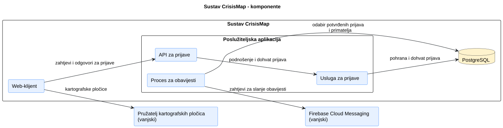
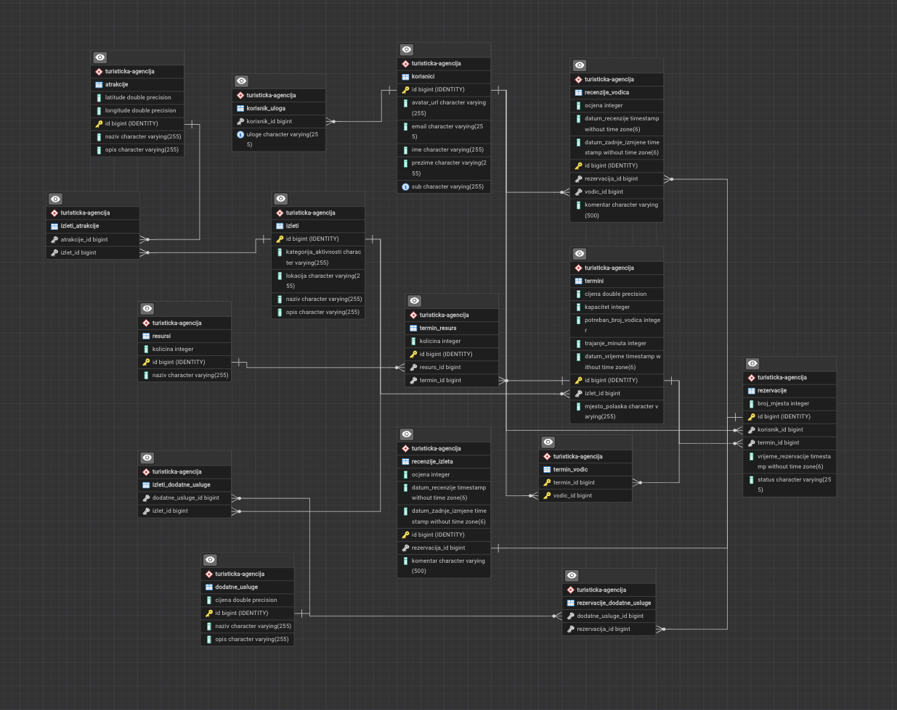
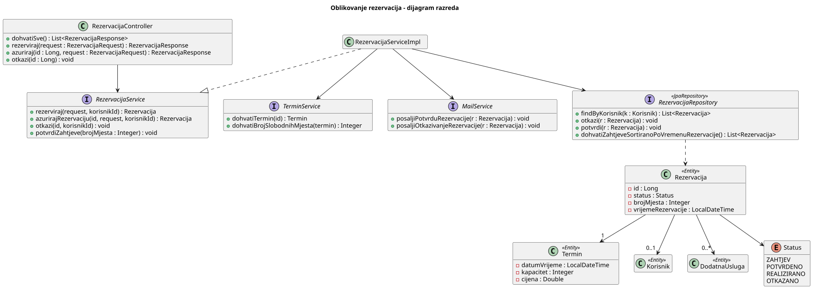
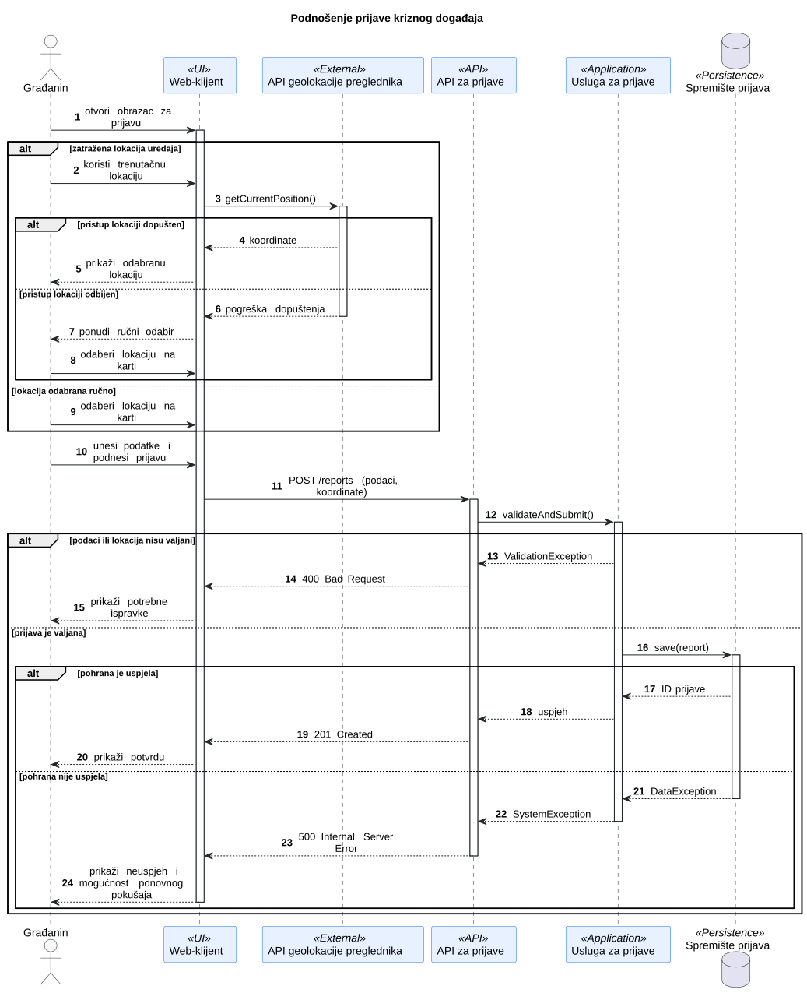
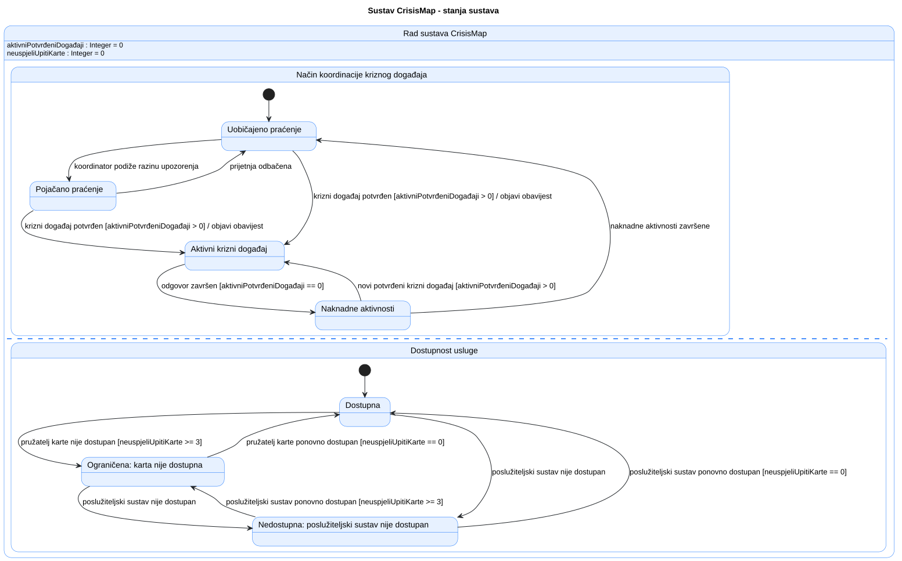

# 4. Arhitektura i oblikovanje

## 4.1 Ključne arhitekturne odluke

| Odluka | Razmatrana alternativa | Projektno specifično obrazloženje i kompromis |
| --- | --- | --- |
| Jedna Spring Boot poslužiteljska aplikacija s REST API-jem, slojevito podijeljena na kontrolere, servise i repozitorije | Zasebno postavljene usluge | Za opseg projekta i jedan semestar jedna aplikacija jednostavnija je za razvoj i postavljanje. Odgovornosti su odvojene po slojevima i domenskim cjelinama (izleti, termini, rezervacije, korisnici, recenzije), ali kvar poslužitelja zaustavlja sve funkcije odjednom. |
| React web-klijent u pregledniku, responzivan, koji će uključivati i digitalni vodič | Zasebna mobilna aplikacija | Jedan klijent radi na računalu, tabletu i mobitelu (NF-02). Lokacija za digitalni vodič dohvaća se preko preglednika, što zahtijeva HTTPS i dopuštenje korisnika (AS-03). |
| Relacijska baza PostgreSQL | Dokumentna baza | Podaci su usko povezani (izlet – termin – rezervacija – korisnik), a transakcije omogućuju sigurnu provjeru kapaciteta (F-005, NF-01). |
| Prijava isključivo putem Googlea (OAuth 2.0 / OpenID Connect) uz sesiju na poslužitelju | Vlastita registracija s lozinkom | Zahtjev kolegija (C-01); aplikacija ne pohranjuje lozinke. Nakon prijave poslužitelj pamti korisnika u sesiji (kolačić `JSESSIONID`), a uloge provjerava za svaki zahtjev. Korisnik bez Google računa ne može se prijaviti. |
| Provjera slobodnih mjesta na poslužitelju unutar transakcije, uz zaključavanje termina | Provjera samo u korisničkom sučelju | Klijent može imati zastarjele podatke, pa samo poslužitelj može jamčiti da se kapacitet ne premaši (F-005, NF-01). Pri stvaranju rezervacije termin se zaključava u bazi (`PESSIMISTIC_WRITE`), pa se istodobne rezervacije istog termina obrađuju jedna za drugom. Kompromis je kratko čekanje drugog zahtjeva. |
| Shemu baze stvara Hibernate iz JPA entiteta pri svakom pokretanju | Ručno pisane SQL skripte za stvaranje i izmjenu tablica | Tijekom razvoja model se često mijenja pa automatsko stvaranje sheme ubrzava rad. Kompromis je da se pri svakom pokretanju podaci brišu i ponovno pune testnim podacima, što prije produkcije treba zamijeniti trajnim rješenjem. |
| OpenStreetMap za prikaz karte | Google Maps | Besplatno, bez obaveznog ključa ili kartice za naplatu; nudi manje dodatnih mogućnosti od Google Mapsa. |

## 4.2 Gradivni blokovi i UML dijagram komponenata

**Cilj:** Prikazati logičku podjelu programa na komponente, njihova sučelja i vanjske integracije. Dijagram komponenata prikazuje logičku organizaciju, dok dijagram razmještaja prikazuje fizičko izvođenje. Ovaj prikaz ažurirajte kako sustav poprima konačan oblik.

**Dijagram komponenata:** [Ugradite čitljiv UML dijagram komponenata.]  
**PlantUML izvor:** [Poveznica na odgovarajuću `.puml` datoteku.]

| Komponenta | Odgovornost | Razlog za ovu granicu |
| --- | --- | --- |
|  |  |  |

Započnite crtanjem granice oko predloženog sustava. Unutar nje prepoznajte dijelove s različitim odgovornostima; planiranu bazu podataka aplikacije smjestite unutar granice, a usluge trećih strana izvan nje. Važne veze označite podatkom ili uslugom koja njima prolazi. Logička komponenta može biti modul unutar jedne poslužiteljske aplikacije: zaseban pravokutnik ne znači zasebno postavljenu uslugu. Tijekom implementacije ažurirajte dijagram kada se promijene odgovornosti ili veze. U završnoj inačici čitatelj treba moći povezati njegove dijelove s kodom. Dijagram razmještaja odgovara na pitanje gdje se ti dijelovi stvarno izvode.

<strong>Granica sustava, odgovornosti i vanjske ovisnosti</strong>

**Primjer — CrisisMap:** Predložena arhitektura podržava podnošenje prijava kriznih događaja, prikaz na karti i obavijesti o potvrđenim prijavama.

**Slika 4.1. Dijagram komponenata sustava CrisisMap**

**PlantUML izvor:** [izvor](./puml/4-1-crisismap-system-CMP.puml)

| Dio | Odgovornost | Razlog za ovu granicu |
| --- | --- | --- |
| Web-klijent | Prikazuje prijave i prikuplja podatke za novu prijavu. | Korisnička interakcija odvojena je od pravila prijave i trajne pohrane. |
| API za prijave | Prihvaća zahtjeve za rad s prijavama i vraća odgovore. | Odgovornosti izložene putem HTTP-a odvojene su od obrade prijava. |
| Usluga za prijave | Primjenjuje pravila prijave i pristupa pohranjenim prijavama. | Pravila provjere valjanosti i pohrane prijava imaju jasno mjesto odgovornosti. |
| Proces za obavijesti | Određuje korisnike koji trebaju primiti obavijest i traži od vanjskog pružatelja da je pošalje. | Obrada obavijesti odvojena je od odgovaranja na korisnikov zahtjev za prijavu. |

**Analiza primjera:** Vanjska granica odvaja predloženi sustav od pružatelja kartografskih usluga i pružatelja obavijesti. Unutarnja granica grupira API za prijave, uslugu za prijave i proces za obavijesti unutar jedne poslužiteljske aplikacije; njihovi zasebni simboli prikazuju predložene odgovornosti, a ne neovisno postavljene usluge. PostgreSQL pohranjuje podatke aplikacije, dok pružatelj kartografskih usluga osigurava kartografske pločice. Strelice sažimaju ovisnosti, a ne redoslijed transakcije; taj redoslijed prikazuje sekvencijski dijagram. Izostavite proces za obavijesti i Firebase Cloud Messaging ako obavijesti nisu dio odobrenog opsega. Pružatelja prijave u sustav uključite samo ako to zahtijeva odobreni zadatak. Kako implementacija napreduje, ispravite svaku predloženu granicu koja se pokaže netočnom; završni dijagram mora odgovarati onome što je tim izgradio. Jedan koherentan prikaz komponenata korisniji je od nekoliko gotovo jednakih inačica s proturječnim vezama.

## 4.3 Model podataka i oblikovanje razreda

### 4.3.1 ER dijagram i model podataka

**Slika 4.2. ER dijagram aplikacije za upravljanje izletima**

**Izvor dijagrama:** generiran iz sheme baze `turisticka-agencija` alatom za ERD u pgAdminu.

**Implementacija:** JPA entiteti u `backend/src/main/java/hr/fer/progi/backend/model/`; Hibernate iz njih stvara shemu `turisticka-agencija`.

Izlet ima više termina, a svaki termin ima vlastiti datum i vrijeme, trajanje, cijenu, kapacitet, mjesto polaska i potreban broj vodiča (odjeljak 2.5). Dodatne usluge i točke interesa vežu se uz izlet preko vezničkih tablica `izleti_dodatne_usluge` i `izleti_atrakcije`. Rezervacija pripada jednom terminu i jednom korisniku i može uključivati više dodatnih usluga (`rezervacije_dodatne_usluge`). Uloge korisnika spremaju se u tablicu `korisnik_uloga`, pa jedan korisnik može imati više uloga (AS-05). Vodiči su korisnici s ulogom vodiča i terminu se dodjeljuju preko tablice `termin_vodic` (AS-04), a resursi preko `termin_resurs`, koja pamti dodijeljenu količinu (npr. 2 od 3 kombija). Točke interesa spremaju se u tablicu `atrakcije` s geografskom širinom i dužinom. Broj slobodnih mjesta ne sprema se, nego se računa iz kapaciteta termina umanjenog za mjesta potvrđenih i realiziranih rezervacija; rezervacije sa statusom `ZAHTJEV` ne zauzimaju mjesta. Recenzija izleta vezana je uz jednu rezervaciju (`recenzije_izleta`, najviše jedna po rezervaciji), a recenzija vodiča uz rezervaciju i vodiča (`recenzije_vodica`, najviše jedna po paru rezervacija–vodič) (F-019, F-020).

### 4.3.2 Reprezentativni UML dijagram razreda

**Slika 4.3. Dijagram razreda za rezervacije**

**PlantUML izvor:** [izvor](./puml/4-3-rezervacije-CD.puml)

**Referenca na kod:** `controller/RezervacijaController.java`, `service/impl/RezervacijaServiceImpl.java`, `repository/RezervacijaRepository.java`, `repository/TerminRepository.java`

Kao reprezentativni dio odabrane su rezervacije jer sadrže najvažnije poslovno pravilo: ne smije se rezervirati više mjesta nego što ih termin ima. `RezervacijaController` samo prima HTTP zahtjeve i prosljeđuje ih servisu. `RezervacijaServiceImpl` provodi pravila: pri stvaranju rezervacije zaključava termin preko `TerminRepository.findByIdForUpdate`, provjerava slobodna mjesta preko `TerminService` i određuje status `POTVRDENO` ili `ZAHTJEV`. Nakon otkazivanja ili smanjenja broja sudionika poziva `potvrdiZahtjeve`, koji preko `RezervacijaRepository.dohvatiZahtjeveZaTermin` dohvaća zahtjeve redoslijedom podnošenja i potvrđuje one koji stanu u slobodna mjesta. Potvrde se šalju preko `MailService`, čija implementacija još nije dovršena. Servisi su definirani kao sučelja pa se u testovima mogu zamijeniti.

## 4.4 Ponašanje tijekom izvođenja

**Cilj:** Objasniti jednu važnu interakciju među dijelovima koji se izvode i životni ciklus jednog smislenog objekta. Odaberite primjere koji otkrivaju odluke ili neuspješne putove umjesto izrade dijagrama za svaku CRUD radnju.

### 4.4.1 Reprezentativni UML sekvencijski dijagram

**Cilj:** Prikazati redoslijed poruka za jedan reprezentativni scenarij i odgovore na važnu alternativu.

**Scenarij:** Rezervacija izleta (UC-003)

**Slika 4.4. Sekvencijski dijagram rezervacije izleta**

**PlantUML izvor:** 

<strong>Odabir lokacije, provjera valjanosti i podnošenje prijave</strong>

**Primjer — CrisisMap:** Građanin podnosi prijavu kriznog događaja nakon što ručno odabere lokaciju ili zatraži položaj uređaja. Interakcija prikazuje i što se događa kada je pristup lokaciji odbijen, podaci prijave nisu valjani ili pohrana ne uspije.

**Slika 4.4. Sekvencijski dijagram podnošenja prijave kriznog događaja**

**PlantUML izvor:** [izvor](./puml/4-4-crisismap-report-submission-SD.puml)

**Analiza primjera:** Dva načina odabira lokacije te alternative provjere i pohrane imaju različite posljedice za korisnika; usporedite ih s odgovarajućim obrascem uporabe i njegovim alternativnim tijekovima. API preglednika za lokaciju mogućnost je preglednika; web-klijent, API, usluga i pohrana odgovaraju prikazu komponenata. Odaberite grane koje pomažu objasniti scenarij vašeg projekta i završni dijagram uskladite s implementiranom interakcijom.

### 4.4.2 Reprezentativni UML dijagram stanja

**Cilj:** Prikazati važna stanja jednog domenskog objekta ili eksplicitno upravljanog načina rada sustava te događaje ili uvjete koji ih mijenjaju.

**Vlasnik stanja i razlog odabira:** [Navedite objekt ili način rada sustava, kako se njegovo stanje prepoznaje i zašto su prijelazi važni.]  
**Dijagram stanja:** [Ugradite čitljiv UML dijagram stanja.]  
**PlantUML izvor:** [Poveznica na odgovarajuću `.puml` datoteku.]

<strong>Složeno stanje sustava: koordinacija događaja i dostupnost usluge</strong>

**Primjer — CrisisMap:** Ovaj primjer ne prikazuje životni ciklus jednog domenskog objekta, nego dva neovisna aspekta stanja cijelog sustava CrisisMap. Jedna regija opisuje način koordinacije kriznog događaja, a druga opaženu dostupnost usluge. Budući da se ta dva aspekta mogu mijenjati neovisno jedan o drugome, prikazani su kao ortogonalne regije istog složenog stanja sustava.

**Slika 4.5. Dijagram stanja sustava s ortogonalnim regijama**

**PlantUML izvor:** [izvor](./puml/4-5-crisismap-system-SM.puml)

**Analiza primjera:** Vlasnik stanja u ovom je primjeru sustav CrisisMap, a ne pojedinačna prijava kriznog događaja. Dvije ortogonalne regije opisuju stanja koja vrijede istodobno: način koordinacije kriznog događaja i dostupnost usluge. Promjena stanja u jednoj regiji ne mora promijeniti stanje u drugoj; primjerice, aktivni krizni događaj može postojati dok je usluga potpuno ili djelomično dostupna.

Prijelazi imaju imenovane događaje ili uvjete, a grane nakon oporavka poslužiteljskog sustava uzimaju u obzir da pružatelj kartografskih usluga može i dalje biti nedostupan. Time primjer pokazuje situaciju u kojoj ortogonalne regije imaju stvarnu semantičku svrhu, a nisu samo način vizualnog grupiranja elemenata.

Ovo je napredniji primjer dijagrama stanja. Koristite takav oblik samo ako sustav stvarno održava dva ili više međusobno neovisnih aspekata stanja koji se mogu mijenjati istodobno. Za projekt u kojem je važan životni ciklus jednog objekta, primjerice prijave, rezervacije ili narudžbe, jednostavniji dijagram stanja tog objekta obično je prikladniji. Složenost dijagrama nije kriterij vrednovanja.

Pri završnom pregledu svaki prikazani prijelaz i uvjet usporedite s ponašanjem koje implementirana aplikacija stvarno podržava.

## 4.5 Zapisi arhitekturnih odluka

**Cilj:** Sačuvati razloge i obrazložiti odabrane važne arhitekturne odluke kada tablica u odjelku 4.1 nije dovoljna za očuvanje konteksta, razmatranih alternativa i prihvaćenih kompromisa.

Napišite nekoliko ADR-a za važne odluke čije obrazloženje, alternative i kompromis treba sačuvati. Ostale arhitekturne odluke dovoljno je zabilježiti u tablici.

**Detaljni zapis arhitekturne odluke (engl. Architecture Decision Record, ADR), kada odluka zahtijeva dodatno objašnjenje:**

### ADR-[ID]: [Naslov odluke]

| Polje                  | Zapis odluke                                                                            |
| ---------------------- | --------------------------------------------------------------------------------------- |
| Kontekst i cilj        | [Koji je arhitekturni problem učinio ovu odluku potrebnom?]                             |
| Kriteriji odluke       | [Što je timu stvarno bilo važno?]                                                       |
| Razmatrane alternative | [Realne mogućnosti koje je tim razmotrio, ukratko.]                                     |
| Odluka i obrazloženje  | [Odabrana mogućnost, zašto je odabrana i čega se tim odrekao.]                          |
| Status                 | [Predloženo, prihvaćeno ili zamijenjeno; ako je primjenjivo, poveznica na novu odluku.] |

ADR pišite samo za odluku čije će obrazloženje ostati važno i nakon promjene implementacije. Značajna promjena odluke može se zabilježiti novim ADR-om koji zamjenjuje stari; rutinski odabiri alata ne trebaju detaljne zapise. Promjene dogovorenog opsega pripadaju zahtjevima i njihovoj povijesti promjena; povratna informacija o zadatku ostaje uz odgovarajući zadatak.

<strong>Odabir jednog poslužiteljskog sustava umjesto zasebno postavljenih usluga</strong>

**Primjer — CrisisMap, ADR-01:**

| ID     | Datum          | Odluka                                     | Razmatrana alternativa                          | Obrazloženje i kompromis                                                                                                      | Status     |
| ------ | -------------- | ------------------------------------------ | ----------------------------------------------- | ----------------------------------------------------------------------------------------------------------------------------- | ---------- |
| ADR-01 | [Datum odluke] | Jedan poslužiteljski API za obradu prijava | Zasebno postavljene usluge za prijave i resurse | Manji napor postavljanja i integracije za odobreni opseg; kvar poslužiteljskog sustava može utjecati na obje funkcionalnosti. | Prihvaćeno |

### ADR-01: Jedan poslužiteljski API za obradu prijava

| Polje                  | Zapis odluke                                                                                                                                                                                                   |
| ---------------------- | -------------------------------------------------------------------------------------------------------------------------------------------------------------------------------------------------------------- |
| Kontekst i cilj        | Tim tijekom jednog semestra mora izraditi i javno postaviti prijavljivanje kriznih događaja i prikaz usmjeren na kartu.                                                                                        |
| Kriteriji odluke       | Tim može izraditi, integrirati, postaviti i objasniti rješenje; komponente i dalje imaju prepoznatljive odgovornosti.                                                                                          |
| Razmatrane alternative | **Jedan poslužiteljski sustav:** moduli dijele aplikaciju koja se postavlja kao cjelina. **Zasebne usluge:** svaka se može izvoditi neovisno, ali zahtijeva dodatni rad na integraciji i postavljanju.         |
| Odluka i obrazloženje  | Odabrati jedan poslužiteljski sustav s jasno odvojenim odgovornostima vezanim uz prijave. Time se smanjuje rad na postavljanju, uz prihvaćanje da kvar tog sustava može istodobno utjecati na rad s prijavama. |
| Status                 | Prihvaćeno.                                                                                                                                                                                                    |

**Analiza primjera:** Strategija rješenja navodi trenutačni pristup; ADR-01 čuva alternative i kriterije koji su do njega doveli. Dijagrami komponenata i razmještaja trebaju odražavati odabrani pristup kako se sustav razvija. Zaseban ADR koristan je za važnu odluku, a ne za svaki odabir alata.

## 4.6 Zajednička pravila oblikovanja (engl. Cross-cutting concerns)

**Cilj:** Prepoznati i opisati globalna pravila i mehanizme oblikovanja koji se primjenjujuju u više dijelova aplikacije, navesti gdje se planira primijeniti i ažurirati objašnjenje kako implementacija poprima konačan oblik. Uključite samo pravila koja su važna za ovaj projekt.

**Implementirani mehanizmi:**

| Aspekt                     | Mehanizam                        | Pravilo                                                                                                                                             | Mjesto primjene                                             |
| -------------------------- | -------------------------------- | --------------------------------------------------------------------------------------------------------------------------------------------------- | ----------------------------------------------------------- |
| [Npr. Sigurnost]           | [Npr. Autorizacija korisnika]    | [Npr. Ovlasti se provjeravaju na poslužiteljskoj strani za svaki zaštićeni zahtjev; skrivanje elemenata korisničkog sučelja nije dovoljna zaštita.] | [Npr. Middleware za autorizaciju / zaštita API usmjernika.] |
| [Npr. Validacija podataka] | [Npr. Provjera ulaznih podataka] | [Npr. Geoprostorni podaci, uključujući koordinate, provjeravaju se prije pohrane.]                                                                  | [Npr. Sloj za obradu zahtjeva / odgovarajuća usluga.]       |

<strong>Primjer zajedničkih pravila i mehanizama</strong>

**Primjer — CrisisMap:**

| Aspekt                  | Mehanizam                        | Pravilo                                                                                                                                                            | Mjesto primjene                                                                         |
| ----------------------- | -------------------------------- | ------------------------------------------------------------------------------------------------------------------------------------------------------------------ | --------------------------------------------------------------------------------------- |
| Sigurnost               | Autorizacija moderiranja prijava | Ovlasti moderatora provjeravaju se na poslužiteljskoj strani prije odobravanja ili odbijanja prijave; skrivanje gumba u korisničkom sučelju nije dovoljna zaštita. | Poslužiteljski dio funkcionalnosti za moderiranje prijava.                              |
| Validacija podataka     | Provjera lokacije prijave        | Nedostajuće ili nevaljane koordinate odbijaju se prije pohrane prijave.                                                                                            | Obrada podnošenja prijave.                                                              |
| Aspekt                  | Mehanizam                        | Pravilo                                                                                                                                                            | Mjesto primjene                                                                         |
| Upravljanje ovisnostima | Injektiranje ovisnosti           | Objekt koji provodi poslovnu logiku ne stvara sam konkretnu implementaciju repozitorija, nego potrebnu ovisnost prima izvana.                                      | `ReportWorkflow` prima implementaciju sučelja `ReportRepository` pri stvaranju objekta. |

**Analiza primjera:** Prvi redak pokazuje sigurnosno pravilo koje se provodi neovisno o korisničkom sučelju, a drugi pravilo provjere podataka prije pohrane. U vlastitoj dokumentaciji navedite samo aspekte koji se stvarno primjenjuju u projektu te konkretno mjesto njihove primjene.

Obrasci poput injektiranja ovisnosti (engl. Dependency Injection) ili repozitorija (engl. Repository) pripadaju ovdje samo kada ih kod stvarno koristi i kada objašnjavaju zajedničko pravilo oblikovanja. Tvrdnja „sustav koristi autentikaciju” sama po sebi ne govori čitatelju gdje se provjera provodi niti što štiti. Sigurnost, bilježenje događaja i obrada pogrešaka ne trebaju svaki zaseban pododjeljak po zadanom pravilu.

## 4.7 Arhitekturni rizici i tehnički dug

**Cilj:** Navesti stvarne tehničke ili domenske rizike i svjesno prihvaćene kompromise oblikovanja, njihove posljedice i način na koji ih tim obrađuje.

**Tehnički rizici i dug**

| Rizik ili kompromis                        | Posljedica                                                                   | Odgovor na rizik                                                                         |
| ------------------------------------------ | ---------------------------------------------------------------------------- | ---------------------------------------------------------------------------------------- |
| _Npr. Pohrana slika u lokalni file sustav_ | _Pri ponovnom pokretanju kontejnera slike će biti izgubljene._               | _Prihvaćeni tehnički dug za demo verziju. U budućnosti planirana migracija na S3 (AWS)._ |
| _Npr. Nepostojanje paginacije na API-ju_   | _Moguće usporenje klijenta pri dohvaćanju velike količine podataka iz baze._ | _Ograničen broj testnih unosa. Dodavanje paginacije ostavljeno za sljedeću iteraciju._   |
|                                            |                                                                              |                                                                                          |

**Poslovni ili domenski rizici, ako su značajni**

| Rizik                                          | Posljedica                                                                            | Odgovor na rizik                                                                                                                    |
| ---------------------------------------------- | ------------------------------------------------------------------------------------- | ----------------------------------------------------------------------------------------------------------------------------------- |
| **Jedna instanca aplikacije obrađuje prijave** | Kvar poslužitelja (hostinga) privremeno onemogućuje nove prijave.                     | Prihvaćeno u okviru ograničenja projekta za kolegij; tim ne tvrdi da postoji automatsko prebacivanje na pričuvni sustav (failover). |
| **Nedostupnost vanjskke kartografske usluge**  | Prikaz karte može prestati raditi iako su pohranjene prijave u bazi i dalje dostupne. | Implementirana je korisniku vidljiva poruka o pogrešci uz alternativu pregleda prijava u tekstualnom obliku.                        |
|                                                |                                                                                       |                                                                                                                                     |

<strong>Primjer tehničkih i domenskih rizika</strong>

**Primjer — CrisisMap, tehnički rizici:**

| Rizik ili kompromis                                    | Posljedica                                                                     | Odgovor na rizik                                                                                |
| ------------------------------------------------------ | ------------------------------------------------------------------------------ | ----------------------------------------------------------------------------------------------- | --------------------------------------------------------------------------------------------------- |
| Jedna instanca aplikacije obrađuje podnošenje prijava. | Kvar smještaja aplikacije privremeno onemogućuje nove prijave.                 | Rizik je prihvaćen za opseg projekta; ne uvodi se pričuvna instanca ni automatsko prebacivanje. |
| Vanjske kartografske usluge nisu dostupne.             | Prikaz karte može prestati raditi iako su pohranjene prijave i dalje dostupne. | Karta se ne može prikazati, ali pohranjene prijave ostaju dostupne.                             | Aplikacija prikazuje poruku o nedostupnosti karte i omogućuje pregled prijava u tekstualnom obliku. |

**Primjer — CrisisMap, domenski rizik:** Čitatelji mogu neprovjerenu prijavu građanina zamijeniti za službeno upozorenje. Tim može u sučelju jasno razlikovati status provjere prijave i uputiti korisnike na službene izvore.

**Analiza primjera:** Prvi tehnički rizik prihvaća realistično ograničenje projekta kolegija; domenski se rizik odnosi na način na koji čitatelj tumači prijavu. Zabilježite ograničenje i realan odgovor koji pripadaju vašem projektu. Neostvarena obavezna funkcionalnost nije tehnički dug nego nedovršen opseg.

---

> **Završna provjera:** Usporedite dijagrame komponenata, podataka, razreda, sekvencijski dijagram i dijagram stanja s implementiranim kodom, ponašanjem aplikacije i stvarnim razmještajem. Ažurirajte zastarjele opise oblikovanja i objasnite svaku važnu razliku koja ostaje; poveznice na odgovarajući kod ili ispitivanja korisne su kada odgovaraju na konkretno pitanje.
